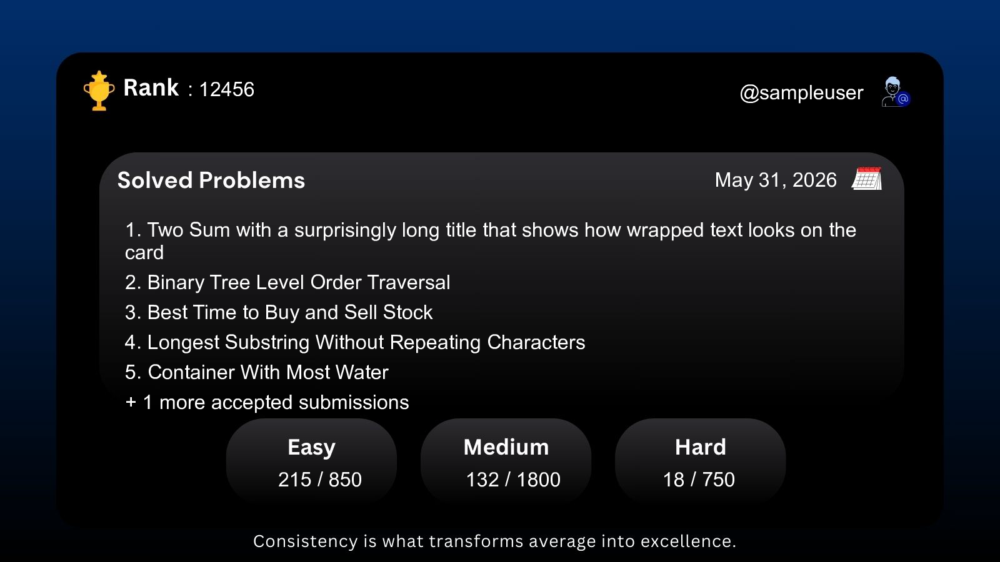

# LeetCode Twitter Post

Turn your daily LeetCode progress into a shareable image card and an X/Twitter share link from the command line.


## Overview

This project fetches a LeetCode profile, filters today's accepted submissions, generates a progress card, and opens a prefilled share URL that you can post on X/Twitter.

It is built for people who want a lightweight CLI workflow instead of manually assembling screenshots and captions every day.

## Features

- Fetches LeetCode profile stats from the GraphQL endpoint.
- Keeps only today's accepted submissions and removes duplicate problems.
- Generates a polished image card with wrapped titles for longer problem names.
- Saves output to your Desktop by default or to a custom directory.
- Opens the share URL in your default browser or a browser you choose.
- Includes a built-in Node test suite and a reproducible sample image generator.

## Visual Preview

### AI-generated README hero

The hero image above is an AI-generated concept illustration created for this repository README.

### Real sample output

The image below is generated by the project itself through `npm run generate:sample`.



## Installation

```bash
git clone https://github.com/kenil-kanani/Leetcode-Twitter-Post.git
cd Leetcode-Twitter-Post
npm install
```

## Usage

```bash
npm start -- <leetcode-username>
```

Example:

```bash
npm start -- kenilkanani
```

### CLI options

| Option | Description |
| --- | --- |
| `--browser <name>` | Choose a browser app such as `chrome`, `firefox`, `edge`, or `default`. |
| `--no-open` | Generate the image without opening the share URL. |
| `--output-dir <path>` | Save the generated image to a custom directory. |
| `--help` | Show usage information. |

Example with options:

```bash
npm start -- kenilkanani --browser chrome --output-dir ./assets/generated
```

## Output

By default, the generated image is saved to your Desktop.

If you pass `--output-dir`, the image is saved in that directory instead.

After the image is created, the tool opens a prefilled X/Twitter share link unless you pass `--no-open`.

## Development

Run the test suite:

```bash
npm test
```

Regenerate the sample README image:

```bash
npm run generate:sample
```

## Project Structure

```text
src/
  browser.js
  cli.js
  date.js
  generateImage.js
  index.js
  leetcode.js
  leetcodeQuery.js
  tweetPost.js
scripts/
  generateSample.js
tests/
  *.test.js
assets/
  readme-hero.png
  sample-output.png
```

## Notes

- The generated README hero image is an illustrative asset and not project output.
- The sample output image in `assets/sample-output.png` is produced by the application itself.
- Browser names can differ across platforms. If needed, you can pass an app name that works on your machine.

## License

[MIT](./LICENSE)
